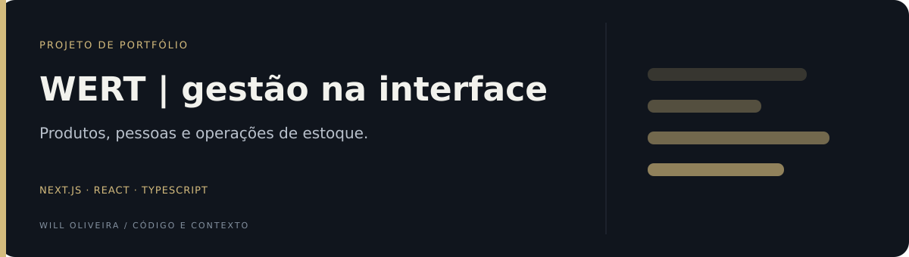

<p align="center">
  
</p>

# WERT · interface de gestão

Cadastros, produtos e operações de estoque em uma interface administrativa.

**Next.js · React · TypeScript · Tailwind CSS**

[Backend](https://github.com/Will-Ifes/wert-backend) · [Código](src) · [Execução](#executar)

## Explore o diferencial

| Ponto de entrada | O que observar |
| --- | --- |
| [Fluxos administrativos](src/app/inventory/page.tsx) | As abas separam consulta, entradas, saídas e movimentações de estoque. |
| [Reutilização na UI](src/components/ui) | Primitivas compartilhadas apoiam formulários, tabelas e diálogos. |

## O projeto

| Área | Conteúdo versionado |
| --- | --- |
| Autenticação | Login, cadastro e integração com a API |
| Produtos | Listagem e componentes de edição e confirmação de exclusão |
| Inventário | Consulta, entrada, saída e movimentações em abas |
| Usuários | Listagem e componentes de edição e visualização |
| Navegação | Header, sidebar e componentes de proteção de rotas |
| UI | Formulários, tabelas, diálogos, alertas e feedback |

<details>
<summary><strong>Arquitetura e caminhos de leitura</strong></summary>

### Arquitetura

| Caminho | Responsabilidade |
| --- | --- |
| [src/app](src/app) | Rotas e páginas do App Router |
| [src/actions/user.ts](src/actions/user.ts) | Integração de cadastro e autenticação |
| [src/components/application-bases](src/components/application-bases) | Estrutura de navegação e proteção de páginas |
| [src/components/ui](src/components/ui) | Primitivas de interface |
| [src/types](src/types) | Tipos de domínio usados pelo frontend |

A UI utiliza Radix e utilitários de composição de classes. Formulários usam React Hook Form e Zod. Os componentes de proteção da interface ajudam na navegação, mas a autorização dos dados precisa ser garantida pela API.

### Por dentro do código

- [Organização do inventário em abas](src/app/inventory/page.tsx).
- [Integração com os endpoints de usuários](src/actions/user.ts).
- [Contrato de login e geração de token](src/app/(auth)/login/validation/route.ts).
- [Componentes de produtos](src/app/products/components).

</details>

<a id="executar"></a>

<details>
<summary><strong>Executar e validar</strong></summary>

Requer Node.js, pnpm e a API configurada. Use as versões de dependências registradas no lockfile.

```bash
git clone https://github.com/Will-Ifes/wert-frontend.git
cd wert-frontend
pnpm install
pnpm dev
```

Antes de iniciar, configure `NEXT_PUBLIC_BACKEND_URL` em `.env.local` com a URL da sua API e `JWT_SECRET` no ambiente do servidor para os fluxos que assinam tokens. O segredo não deve usar prefixo `NEXT_PUBLIC_`. Confira também os endpoints de cada módulo: esta base preserva integrações históricas e requer revisão da configuração local.

A interface usa a porta padrão 3000. Para o backend atual em HTTPS, configure certificados confiáveis no seu ambiente.

### Comandos

| Comando | Finalidade |
| --- | --- |
| `pnpm dev` | Desenvolvimento |
| `pnpm build` | Build do Next.js |
| `pnpm start` | Servidor da build |
| `pnpm lint` | ESLint |
| `pnpm format` | Formatação; modifica arquivos |

Não há suíte de testes automatizados versionada nesta edição. Os comandos foram conferidos no manifesto; esta documentação não declara build validada ou aplicação pronta para produção.

</details>

<details>
<summary><strong>Contexto, evolução e uso</strong></summary>

Trabalho desenvolvido por Will Oliveira no projeto WERT, com colaboração registrada no projeto original. Esta edição de portfólio reúne uma cópia revisada do código com histórico novo; não reproduz o histórico de commits do desenvolvimento original.

### Evolução

- Consolidar a configuração dos endpoints.
- Rever contratos e estados de erro dos formulários.
- Adicionar testes dos fluxos de autenticação e estoque.
- Verificar autorização no backend, acessibilidade e comportamento em telas menores.

### Procedência

Esta cópia foi criada para apresentar o trabalho, removendo arquivos e dados locais do projeto original. A licença de uso do frontend não está definida em um arquivo de licença; consulte o autor para reutilização.

Mantido por **Will Oliveira** · [Perfil](https://github.com/Will-Ifes) · [LinkedIn](https://www.linkedin.com/in/wildemberg-de-jesus-oliveira/)

</details>

---

**Will Oliveira** · [LinkedIn](https://www.linkedin.com/in/wildemberg-de-jesus-oliveira/) · [GitHub](https://github.com/Will-Ifes)
